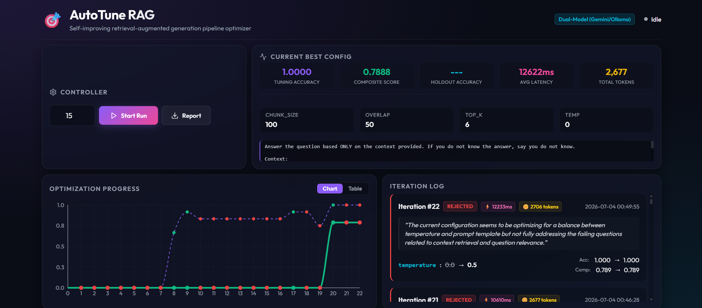
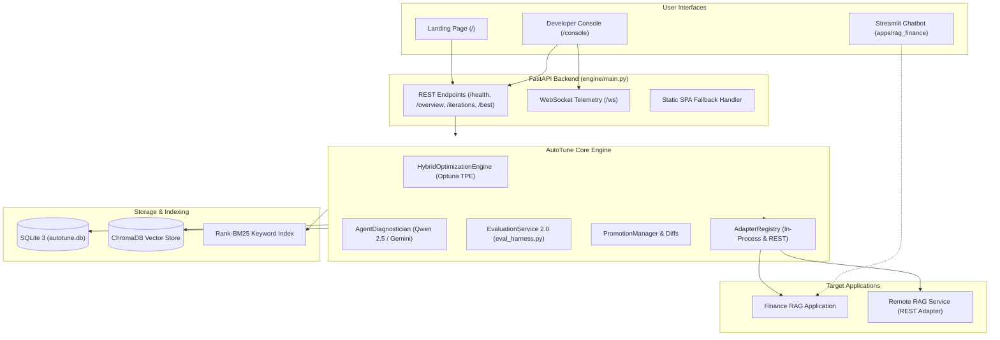

# AutoTune 2.0: RAG Evaluation & Hyperparameter Optimization Platform

[](https://autotune-dashboard.onrender.com)
[](https://rag-finance-dashboard.streamlit.app/)
[](https://www.python.org/)
[](https://fastapi.tiangolo.com/)
[](https://react.dev/)

> **AutoTune** is an evaluation and hyperparameter optimization platform for Retrieval-Augmented Generation (RAG) pipelines. It evaluates RAG systems against structured benchmarks, categorizes retrieval and generation failure modes, explores parameter search spaces using Bayesian optimization, and promotes only candidate configurations that outperform the active baseline on blind holdout sets.

---

## 1. Problem Statement

Production RAG systems suffer from fragile, interconnected hyperparameters that are typically chosen by guesswork:

- **Chunk size & overlap mismatches:** Text sliced too small splits semantic facts across boundaries; text sliced too large dilutes information density with irrelevant text.
- **Arbitrary retrieval depth (Top-K):** Shallow top-k starves the generator of essential context; deep top-k introduces distracting context, increases hallucinations, and drives up token costs and latency.
- **Silent numerical hallucinations:** LLMs frequently alter numbers, percentages, currency units, and financial figures when answering context-dense queries.
- **Uncontrolled regressions:** Tweaking prompts or retrieval parameters to fix one question frequently degrades accuracy across other queries without detection.

---

## 2. What AutoTune Does

AutoTune replaces manual trial-and-error with a measurable, automated optimization loop:

1. **Deterministic Evaluation:** Automatically computes expected-term containment, normalized exact match, citation coverage, and numerical grounding verification.
2. **Diagnostic Analysis:** When benchmark queries fail, an AI diagnostician classifies errors (missing context, ungrounded figures, irrelevant generation, unanswerable violations).
3. **Controlled Exploration:** Leverages Optuna Bayesian Tree-structured Parzen Estimators (TPE) and Random search to generate parameter proposals within valid bounds.
4. **Isolated Experimentation:** Evaluates candidates in temporary, fingerprinted ChromaDB and BM25 index namespaces without touching production state.
5. **Multi-Objective Scoring:** Scores candidates against a composite function balancing Accuracy (70%), Latency (20%), and Token Costs (10%).
6. **Strict Governance:** Proposals that fail validation or score below the baseline are rejected. Valid candidates must pass blind holdout qualification before atomic promotion.

<p align="center">
  
</p>

---

## 3. Measured Optimization Example (Finance RAG Benchmark)

The monorepo includes **RAG-Finance**, an example application indexing Indian tax circulars, GST regulations, RBI monetary policies, and Union Budget 2024 text extracts.

| Hyperparameter | Baseline Configuration (Initial) | AutoTune Tuned Configuration | Measured Impact |
| :--- | :---: | :---: | :--- |
| **Chunk Size** | 200 characters | **500 characters** | Captures complete tables & cohesive clauses |
| **Chunk Overlap** | 20 characters | **50 characters** | Preserves context across chunk boundaries |
| **Top-K Retrieval** | 2 chunks | **3 chunks** | Balances context coverage against token budget |
| **Temperature** | 0.0 | **0.0** | Maintains deterministic generation |
| **Retrieval Strategy** | Vector (ChromaDB) | **Hybrid (Vector + BM25 RRF)** | Fuses semantic vector search with keyword matching |
| **Benchmark Pass Rate** | **50.0%** (7/14 queries passed) | **100.0%** (14/14 queries passed)* | Resolved context fragmentation on GST slab queries |

*\*Note: Measured specifically on the 14-question Finance RAG tuning benchmark set. Real-world performance varies across document corpora and query distributions; AutoTune does not guarantee universal improvements on uncalibrated datasets.*

---

## 4. Core Features

- **Hybrid Optimization Engine:** Integrates Optuna Bayesian TPE and Random search spaces with LLM diagnostic reasoning.
- **Evaluation Engine 2.0:** Multi-metric evaluation harness supporting expected term containment, exact match, numerical grounding verification, and latency percentiles (P50/P95).
- **Universal Application Adapters:** Connect any RAG system via the decoupled `BaseRAGAdapter` Python SDK or SSRF-validated HTTP REST endpoints.
- **Safe Experimental Namespaces:** Uses SHA256 corpus fingerprinting and isolated ChromaDB/BM25 collection namespaces during trials.
- **Promotions & Configuration Diffs:** Parameter-by-parameter diffs comparing active baseline vs candidate champion, guarded by blind holdout gates.
- **Resilient Offline Architecture:** FastAPI backend and React frontend boot cleanly even when inference providers (Ollama) are offline.
- **Low-Memory Profile:** Lazy library imports and a BM25-only fallback mode (`AUTOTUNE_DISABLE_EMBEDDINGS=1`) for memory-constrained container hosts (Render 512 MB Free tier).

---

## 5. System Architecture



---

## 6. Optimization & Evaluation Workflow

```
┌────────────────────────────────────────────────────────┐
│ 1. Connect Target RAG Application (Adapter Protocol)   │
└───────────────────────────┬────────────────────────────┘
                            ▼
┌────────────────────────────────────────────────────────┐
│ 2. Evaluate Active Baseline Configuration              │
│    • Expected term pass rate                           │
│    • Numerical grounding verifier (detect hallucinated │
│      numbers not present in retrieved context)         │
│    • Latency (P50/P95) & token consumption             │
└───────────────────────────┬────────────────────────────┘
                            ▼
┌────────────────────────────────────────────────────────┐
│ 3. Diagnose Weaknesses & Formulate Hypotheses          │
│    • Classify failure categories                       │
│    • Parameter search bounds defined                   │
└───────────────────────────┬────────────────────────────┘
                            ▼
┌────────────────────────────────────────────────────────┐
│ 4. Propose & Validate Candidate Configuration          │
│    • Optuna samples candidate (TPE / Random)           │
│    • Cross-parameter constraint validation             │
└───────────────────────────┬────────────────────────────┘
                            ▼
┌────────────────────────────────────────────────────────┐
│ 5. Isolated Trial Evaluation in Experimental Namespace │
│    • Rebuilds isolated Chroma/BM25 index               │
│    • Computes Composite Score (0.7 Acc + 0.2 Lat + 0.1)|
└───────────────────────────┬────────────────────────────┘
                            ▼
        ┌───────────────────┴───────────────────┐
   Score > Baseline?                       Score <= Baseline?
        ▼                                       ▼
┌───────────────────────────────┐     ┌───────────────────────┐
│ Passed: Qualify Candidate     │     │ Rejected: Revert to   │
│ • Blind Holdout Gate Check    │     │ active baseline state │
│ • Atomic Promotion to Active  │     └───────────────────────┘
└───────────────────────────────┘
```

---

## 7. Supported Integration Adapters

AutoTune decouples the optimization algorithm from the application architecture through its Universal Adapter Protocol:

1. **In-Process Python SDK (`BaseRAGAdapter`):**
   - Direct Python class inheritance for low-latency in-memory evaluation.
   - Implements `get_manifest()`, `get_config()`, `apply_config()`, `query()`, and `health_check()`.
2. **REST RAG Connector (`RestRAGAdapter`):**
   - Connects to any remote RAG service running in Docker, Kubernetes, or another cloud.
   - Built-in SSRF protection (blocks cloud metadata endpoints and loopback tampering).
   - Configurable timeouts, HTTP retries, and Bearer token authentication.
3. **Integration Modes:**
   - **Optimize Mode:** Full bidirectional hyperparameter tuning (chunking, top-k, temperature, prompts).
   - **Observe Mode:** Read-only benchmarking and evaluation monitoring without mutating remote configurations.

---

## 8. Technology Stack

- **Backend:** Python 3.10+, FastAPI, Uvicorn, SQLite 3, Pydantic v2
- **Optimization:** Optuna (Tree-structured Parzen Estimator, Random Search)
- **Retrieval:** ChromaDB (Vector Search), Rank-BM25 (Sparse Keyword Search)
- **Inference Options:** Ollama (local models: `qwen2.5:1.5b`, `llama3.2:latest`) with automatic failover to Google Gemini API
- **Frontend Dashboard:** React 18, Vite 5, Recharts, Lucide Icons, Hallmark Console Design System

---

## 9. Project Structure

```text
AutoTune/
├── engine/                      # Core AutoTune Optimization Engine
│   ├── main.py                  # FastAPI server, WebSocket, static SPA mount
│   ├── agent_loop.py            # Optimization loop coordinator
│   ├── eval_harness.py          # Legacy-compatible evaluation harness
│   ├── config.py                # Active configuration parameters
│   ├── config_validator.py      # Cross-parameter constraints & snapshots
│   ├── db.py                    # SQLite migrations and trial persistence
│   ├── models.py                # Model discovery, health checks & fallback
│   ├── rag_pipeline.py          # Vector + BM25 hybrid indexing & retrieval
│   ├── report.py                # Markdown experiment report generator
│   ├── requirements.txt         # Engine Python dependencies
│   ├── evaluation/              # Evaluation Engine 2.0
│   │   ├── base.py              # EvalSample & report schemas
│   │   ├── dataset_manager.py   # Dataset loader & leak detector
│   │   ├── deterministic_metrics.py # Term pass, exact match, grounding
│   │   ├── evaluation_service.py# Central evaluation orchestrator
│   │   ├── evaluator_registry.py# Standard multi-metric evaluator
│   │   ├── judge_provider.py    # Semantic judge interface
│   │   └── performance_metrics.py# P50, P95, latency calculators
│   ├── integrations/            # Universal RAG Adapter Layer
│   │   ├── base_adapter.py      # Abstract BaseRAGAdapter contract
│   │   ├── finance_adapter.py   # Internal benchmark finance adapter
│   │   ├── rest_adapter.py      # Remote HTTP REST RAG connector
│   │   └── adapter_registry.py  # Active adapter singleton registry
│   └── optimizer/               # Hybrid Optimization Engine
│       ├── agent_diagnostician.py# LLM failure analysis & hypotheses
│       ├── hybrid_engine.py     # Optuna + LLM orchestrator
│       ├── optuna_study.py      # Search space & TPE samplers
│       └── promotion_manager.py # Qualification gates & parameter diffs
├── dashboard/                   # React 18 / Vite Hallmark Console
│   ├── src/
│   │   ├── App.jsx              # Client SPA routing & progressive loading
│   │   ├── api/client.js        # Cached & deduplicated API client
│   │   ├── components/          # Reusable UI components & layouts
│   │   │   ├── LandingPage.jsx  # Public SaaS-style home page
│   │   │   ├── Navbar.jsx       # Universal navigation header
│   │   │   ├── layout/          # Console Header & Sidebar
│   │   │   └── monitor/         # Live experiment WebSocket monitor
│   │   └── views/               # Overview, Applications, Evaluations, etc.
│   ├── package.json             # Frontend dependencies
│   └── vite.config.js           # Vite build & API proxy configuration
├── apps/
│   └── rag_finance/             # Example Finance RAG Consumer Application
│       ├── streamlit_app.py     # Interactive chatbot GUI
│       ├── config.json          # Production configuration mirror
│       └── documents/           # Tax, GST, and budget corpus files
├── tests/                       # Automated backend test suite (45 tests)
└── README.md                    # Project documentation
```

---

## 10. Local Installation & Setup

### Prerequisites
- Python 3.10 or higher
- Node.js 18+ and npm (for dashboard development)
- Optional: [Ollama](https://ollama.ai/) for local offline LLM inference

### Step 1: Clone Repository & Create Virtual Environment
```powershell
git clone https://github.com/R1shabhCodes/AutoTune.git
cd AutoTune

# Create and activate virtual environment
python -m venv .venv
.venv\Scripts\activate      # Windows
# source .venv/bin/activate  # macOS / Linux
```

### Step 2: Install Python Dependencies
```powershell
pip install -r engine/requirements.txt
```

### Step 3: Configure Environment (Optional)
Create an `.env` file in the root or `engine/` directory:
```env
# Optional: Use Google Gemini API if local Ollama is not running
GEMINI_API_KEY=your_gemini_api_key_here

# Optional: Custom Ollama endpoint (defaults to http://localhost:11434)
OLLAMA_URL=http://localhost:11434

# Optional: Low-RAM mode (disables local PyTorch embedding model)
# Recommended for Render Free 512 MB instances
AUTOTUNE_DISABLE_EMBEDDINGS=0
```

### Step 4: Set Up Local Inference Models (If using Ollama)
Ensure the Ollama daemon is running and pull the default models:
```bash
ollama pull qwen2.5:1.5b
ollama pull llama3.2:latest
```
*(Note: If Ollama is not installed or offline, AutoTune will still boot and operate cleanly; if `GEMINI_API_KEY` is present, it will automatically route proposals to Gemini Flash.)*

---

## 11. Running the Platform

### Running the Backend Engine
From the repository root:
```powershell
.venv\Scripts\uvicorn engine.main:app --host 0.0.0.0 --port 8000
```
- Public Landing Page: [http://localhost:8000/](http://localhost:8000/)
- Developer Console: [http://localhost:8000/console](http://localhost:8000/console)
- Interactive API Docs (Swagger): [http://localhost:8000/docs](http://localhost:8000/docs)

### Running the Frontend in Development Mode (Optional)
If modifying React dashboard code with Vite Hot Module Replacement:
```powershell
cd dashboard
npm install
npm run dev
```
Open [http://localhost:5173/](http://localhost:5173/) (proxies API and WebSocket requests to `http://localhost:8000`).

### Running the Finance Chatbot Demo (Streamlit)
In a separate terminal:
```powershell
.venv\Scripts\streamlit run apps/rag_finance/streamlit_app.py
```
Open the Streamlit URL to test user queries against the currently active configuration.

---

## 12. Environment Variables

| Variable | Default Value | Description |
| :--- | :---: | :--- |
| `PORT` | `8000` | Port for the FastAPI server (injected automatically by Render). |
| `OLLAMA_URL` | `http://localhost:11434` | Base URL for the local Ollama inference daemon. |
| `OPTIMIZER_MODEL` | `qwen2.5:1.5b` | Model used by `AgentDiagnostician` to analyze failure distributions. |
| `GENERATOR_MODEL` | `llama3.2:latest` | Model used by target RAG pipeline to generate answers. |
| `GEMINI_API_KEY` | *None* | Google Gemini API key. When present, enables cloud inference fallback. |
| `AUTOTUNE_DISABLE_EMBEDDINGS` | `0` | When set to `1`, disables `SentenceTransformer` and runs pure BM25 search to preserve RAM. |
| `EMBEDDING_MODEL` | `all-MiniLM-L6-v2` | Sentence-transformer model name for local vector embeddings. |

---

## 13. REST & WebSocket API Documentation

All endpoints return JSON and are verified against `tests/test_api_compatibility.py`:

| Method | Endpoint | Description |
| :--- | :--- | :--- |
| `GET` | `/health/status` | Real-time health telemetry for backend, Ollama daemon, and models. |
| `GET` | `/overview/summary` | Aggregate trial counts, acceptance rate, and recent activity from SQLite. |
| `GET` | `/experiments` | List of all optimization experiment studies and aggregated scores. |
| `GET` | `/iterations` | List of historical trial records (supports `?experiment_id=...`). |
| `GET` | `/best` | Current champion configuration and baseline delta metrics. |
| `GET` | `/trials/{trial_id}/evaluations` | Per-question granular evaluation telemetry for a specific trial. |
| `GET` | `/integrations/adapters` | List of registered application adapters and capabilities. |
| `GET` | `/integrations/adapters/{id}` | Manifest, parameter schemas, and live health for a specific adapter. |
| `POST` | `/integrations/connect` | Register a remote RAG REST endpoint (SSRF-protected). |
| `POST` | `/promotion/evaluate` | Run multi-stage qualification gate check on a candidate configuration. |
| `POST` | `/promotion/promote` | Promote a candidate configuration to production active state. |
| `POST` | `/run` | Kick off an optimization loop in the background. |
| `GET` | `/holdout_score` | On-demand evaluation against blind holdout dataset. |
| `GET` | `/report/{run_id}` | Download a formatted Markdown experiment report. |
| `WS` | `/ws` | Real-time WebSocket streaming iteration telemetry & status. |
| `GET` | `/` | Serves public AutoTune Home landing page. |
| `GET` | `/console` | Serves developer console shell (SPA routing). |

---

## 14. Testing & Verification

The repository contains an automated test suite across all architectural layers:

```powershell
# Run full backend test suite (45 tests)
.venv\Scripts\python.exe -m unittest discover -s tests -v
```

### Test Coverage Highlights:
- `tests/test_api_compatibility.py`: Verifies all REST endpoints and SPA fallback routing for `/` and `/console`.
- `tests/test_models.py`: Validates model discovery, offline Ollama handling, Gemini failover, and `AUTOTUNE_DISABLE_EMBEDDINGS` fallback.
- `tests/test_phase1_engine.py`: Baseline isolation, immutable snapshot recovery, and decision rules.
- `tests/test_phase2_evaluation.py`: Deterministic term pass rate, exact match, numerical grounding verifier, and percentiles.
- `tests/test_phase3_integrations.py`: BaseRAGAdapter conformance, SSRF prevention, and REST adapter error recovery.
- `tests/test_phase4_optimizer.py`: Optuna search space dynamic mapping, reproducible seeds, and promotion qualification.

### Building Frontend Assets:
```powershell
npm run build --prefix dashboard
```
Compiles production assets into `dashboard/dist` with zero errors.

---

## 15. Deployment on Render (Native Python 3)

AutoTune is configured to deploy directly as a native Python 3 Web Service on Render:

- **Runtime:** `Python 3`
- **Root Directory:** *(leave blank)*
- **Build Command:**
  ```bash
  pip install -r engine/requirements.txt
  ```
- **Start Command:**
  ```bash
  uvicorn engine.main:app --host 0.0.0.0 --port $PORT
  ```

### Critical Render Free Tier Notes (512 MB RAM):
1. **Memory Budget:** Render Free instances enforce a hard 512 MB memory ceiling. AutoTune uses lazy loading so startup memory consumes only **~20 MB**.
2. **Inference Access:** Render containers cannot reach a developer's local `http://localhost:11434` Ollama daemon. To run live LLM proposals in production, add `GEMINI_API_KEY` to the Render Environment Variables or configure an externally reachable `OLLAMA_URL`.
3. **Low-Memory Setting:** On 512 MB instances, set `AUTOTUNE_DISABLE_EMBEDDINGS=1`. This enables pure BM25 search, allowing the platform to run comfortably within 70–110 MB RAM without risk of OOM container restarts.

---

## 16. Known Limitations & Scope

- **Inference Requirements:** Automatic proposal generation requires a reachable LLM inference provider (Ollama or Gemini API).
- **Single-Node SQLite:** Designed for controlled benchmark trials and continuous evaluation runs. It is not an enterprise distributed database.
- **Empirical Rejection:** AutoTune rejects candidate configurations that do not outperform the baseline composite score. It is an optimizer, not an LLM fine-tuner.
- **Ephemeral Container Storage:** Render Free instances reset local disk storage on container sleep/restart. Historical benchmark runs are preserved in version control or attached volumes.

---

## 17. Future Improvements

- Distributed vector database connectors (Pinecone, Qdrant, Weaviate).
- Automated dataset synthetic query generation using agentic self-instruct.
- Multi-objective Pareto frontier visualization in the React dashboard.
- Native integration hooks for LangSmith and OpenTelemetry traces.

---

## 18. License

This project is licensed under the MIT License — see the repository files for details.
